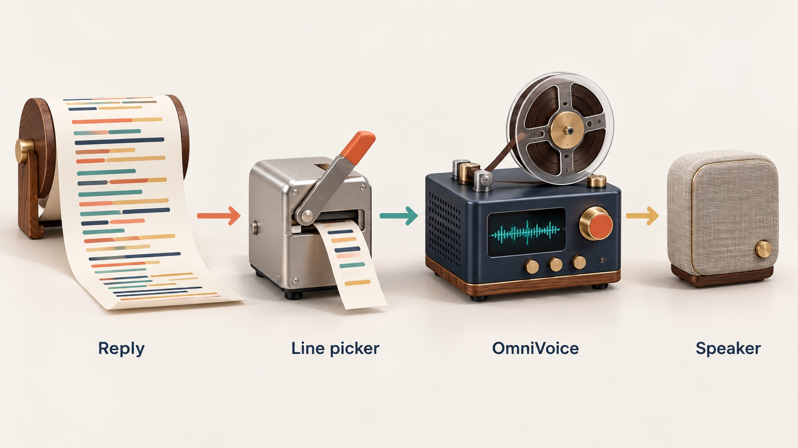
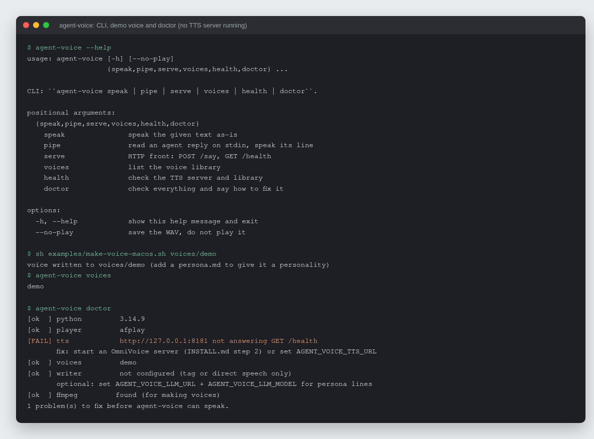

# agent-voice

Give any LLM agent a cloned voice: the agent's reply goes in, and one short
spoken line comes out of your speakers in a voice cloned from a 3 to 10 second
clip.

[](https://github.com/rodaddy/agent-voice/actions/workflows/ci.yml)
[](LICENSE)


## What it is

agent-voice is a small command-line tool, HTTP server and Python library that
turns an agent's text reply into speech. The screen keeps the full technical
answer. The speaker gets one or two sentences, in character, synthesized by an
[OmniVoice](https://github.com/k2-fsa/OmniVoice) text-to-speech server from a
short reference clip.

```sh
my-agent --reply | agent-voice pipe --voice ship-ai
```

## Why it exists

A coding or operations agent that writes long replies is easy to miss when you
are looking at another window. Reading the whole reply aloud is slow and
unpleasant. agent-voice speaks one short line about the reply, so you hear that
a build passed or a task needs you without switching windows, and the detail
stays on screen. It started as a way to let a Claude Code session talk without
a browser in the loop, and it works with any agent that can print to stdout or
make an HTTP call.

## How it works



`pipe` and `POST /say` take a whole reply and choose the spoken line in a fixed
order (`tags.py`, `writer.py`, `speaker.py`). If the agent wrote
`<say>One spoken line.</say>`, exactly that is spoken; tags quoted inside code
spans are ignored. Otherwise, if a writer model is configured, the reply and
the voice's `persona.md` go to any OpenAI-compatible endpoint, which answers
with one or two sentences capped at `AGENT_VOICE_MAX_WORDS`. Otherwise the text
itself is spoken with markup stripped. The chosen line goes to an OmniVoice
`/synthesize` endpoint (`tts.py`) with the voice's reference clip, and the WAV
is saved and played through the platform's player (`play.py`). Utterances are
serialized, so two agents talking at once take turns.



*Real output: `--help`, the macOS demo voice script, `voices`, and `doctor`
reporting the one missing piece (no OmniVoice server was running) with its
fix.*

## Features

- Three ways in: `agent-voice speak` for a string, `agent-voice pipe` for an
  agent's stdout, `agent-voice serve` for anything that can POST JSON.
- Spoken-line cascade: `<say>` tag, then writer model with a persona, then
  direct text (`--mode auto|tag|writer|direct`).
- Works with any server that speaks the OmniVoice `/health` + `/synthesize`
  contract, including
  [scorbo2/ai-playground](https://github.com/scorbo2/ai-playground/tree/master/TTS)
  and [TalkWithMe](https://github.com/scorbo2/TalkWithMe).
- Voice library on disk: `voices/<name>/{ref.wav, ref.txt, language.txt,
  persona.md}`.
- `agent-voice doctor` checks Python, player, TTS server, voices, writer and
  ffmpeg, and prints a fix for each failure.
- Playback on macOS (`afplay`), Linux (`paplay`, `aplay`, `ffplay`) and Windows
  (`winsound`).
- One runtime dependency (`httpx`), a standard-library HTTP server, mypy
  strict, CI on Linux and macOS for Python 3.11 to 3.13.

## Quick start

```sh
git clone https://github.com/rodaddy/agent-voice.git
cd agent-voice
sh install.sh --demo          # venv, install, demo voice (macOS), then doctor
```

Edit `agent-voice.env` (created for you) so `AGENT_VOICE_TTS_URL` points at
your OmniVoice server, then:

```sh
.venv/bin/agent-voice doctor
.venv/bin/agent-voice speak --voice demo "It works."
printf 'Build passed.\n<say>The build is green.</say>\n' | .venv/bin/agent-voice pipe --voice demo
```

The full walkthrough, including running an OmniVoice server, cutting a real
reference clip and choosing a writer model, is in [INSTALL.md](INSTALL.md).

### HTTP and Python

```sh
agent-voice serve                       # http://127.0.0.1:7161
curl -s localhost:7161/say -H 'content-type: application/json' \
  -d '{"text": "Deployed.\n<say>It is live.</say>", "voice": "ship-ai"}'
```

`POST /say` takes `text`, optional `voice` and optional `mode`. It answers
`204` when there was nothing to say, `404` for an unknown voice and `502` if
the TTS or writer failed.

```python
from agent_voice import Config, Speaker

speaker = Speaker(Config.from_env())
spoken = speaker.speak(agent_reply, "ship-ai")   # Spoken(text, wav, voice, source) or None
```

### Configuration

Environment variables, or the same names in `agent-voice.env` in the working
directory (the environment wins). `agent-voice doctor` shows what is in effect.

| Variable | Default | Meaning |
|---|---|---|
| `AGENT_VOICE_TTS_URL` | `http://127.0.0.1:8181` | OmniVoice server |
| `AGENT_VOICE_VOICES_DIR` | `voices` | the voice library |
| `AGENT_VOICE_VOICE` | first voice | default voice name |
| `AGENT_VOICE_LLM_URL` | (unset) | OpenAI-compatible base URL of the writer; unset means no writer |
| `AGENT_VOICE_LLM_MODEL` | | writer model id |
| `AGENT_VOICE_LLM_API_KEY` | | sent as `Authorization: Bearer` if set |
| `AGENT_VOICE_NUM_STEPS` | `10` | OmniVoice diffusion steps |
| `AGENT_VOICE_GUIDANCE_SCALE` | `1.2` | |
| `AGENT_VOICE_MAX_WORDS` | `35` | cap on a writer-produced line |
| `AGENT_VOICE_OUT_DIR` | `out` | where WAVs are saved |
| `AGENT_VOICE_PLAY` | `true` | `false` to only save the WAV |
| `AGENT_VOICE_HOST` / `_PORT` | `127.0.0.1` / `7161` | for `agent-voice serve` |

### Integrations

- [Claude Code](integrations/claude-code/): two hooks and a toggle make a
  Claude Code session speak each reply.
- Anything else needs only a way to run `agent-voice pipe` with the reply on
  stdin, or to POST the reply to `/say`.

### Development

```sh
sh install.sh --dev
.venv/bin/pytest && .venv/bin/ruff check && .venv/bin/ruff format --check && .venv/bin/mypy
```

See [CONTRIBUTING.md](CONTRIBUTING.md).

## How it was built

agent-voice was written and polished in one day, 2026-08-27, as a 0.1.0 release
followed by one pull request that added the installer, `doctor` and CI. The
design choices, what changed in review and how it is tested are in
[docs/BUILD-STORY.md](docs/BUILD-STORY.md).

## Project status

Finished and small on purpose: version 0.1.0, 22 tests, CI green on Linux and
macOS. New integrations and playback backends are welcome; see
[CONTRIBUTING.md](CONTRIBUTING.md).

## Credits

- [OmniVoice](https://github.com/k2-fsa/OmniVoice) (k2-fsa), the zero-shot
  voice-cloning model that does the synthesis.
- scorbo2's [`server_omnivoice.py`](https://github.com/scorbo2/ai-playground/tree/master/TTS)
  and [TalkWithMe](https://github.com/scorbo2/TalkWithMe), whose `/synthesize`
  contract agent-voice speaks.

## Licence

MIT. See [LICENSE](LICENSE).

## Author

Rico Rojas, https://rico-rojas.com
